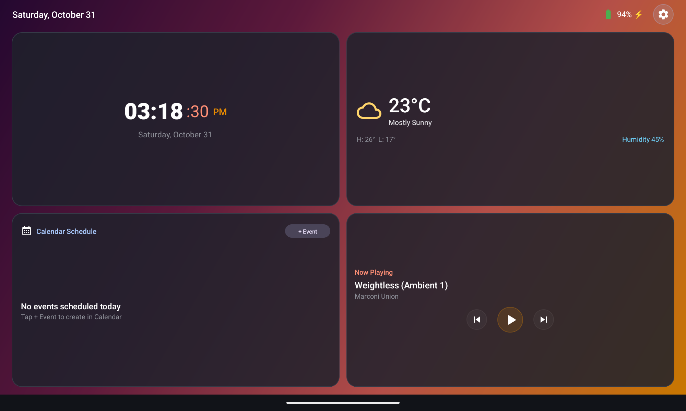
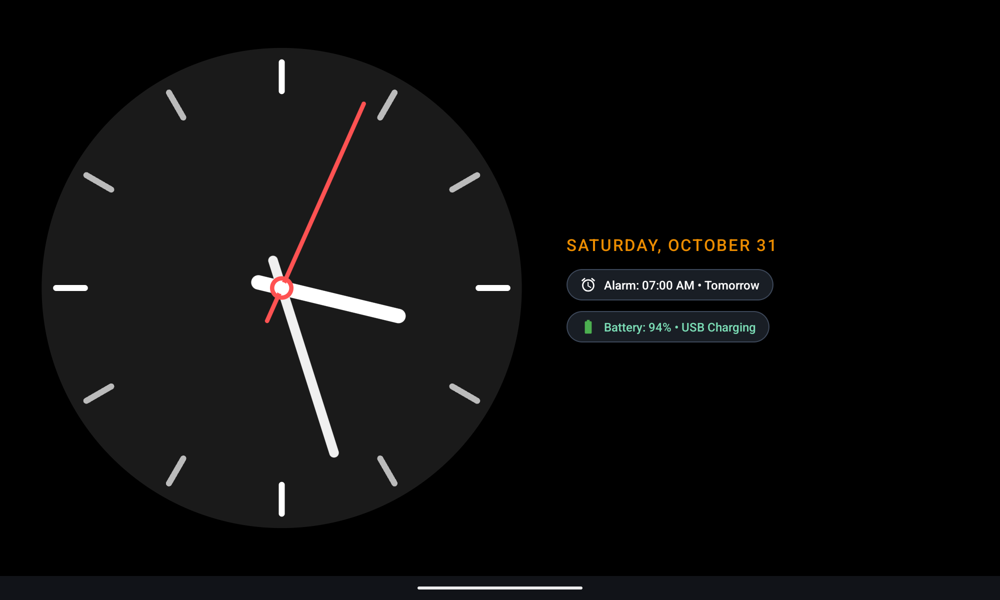

# Nest Bedside Hub 🌟
### The Ambient Smart Display for Android Tablets (Google Nest Meets Apple StandBy)

[-3DDC84?logo=android&logoColor=white)](https://developer.android.com)
[](https://github.com/Omar-Shady780/Nest-Hub/releases/latest)
[](https://opensource.org/licenses/MIT)
[](https://github.com/Omar-Shady780/Nest-Hub)

**Nest Bedside Hub** turns any Android tablet into an ambient Google Nest and Apple StandBy smart display designed for bedside nightstands and desk docks. It features zero-sleep bedside lock protection, vertical swipe StandBy clocks, customizable grid cards with span resizing, 20+ smart widgets, and native Android home screen widget embedding.

---

## 🚀 Live Website & Download

- **Live GitHub Pages Website**: [https://omar-shady780.github.io/Nest-Hub/](https://omar-shady780.github.io/Nest-Hub/)
- **Direct APK Download**: [Download NestBedsideHub.apk (v2.4.0)](https://github.com/Omar-Shady780/Nest-Hub/releases/latest/download/NestBedsideHub.apk)
- **GitHub Repository**: [https://github.com/Omar-Shady780/Nest-Hub](https://github.com/Omar-Shady780/Nest-Hub)

---

## 📸 Screenshots Showcase

| 🏠 Smart Bedside Dashboard | 🌙 OLED StandBy Digital | ⏱️ Chronograph Watchface |
| :---: | :---: | :---: |
|  |  |  |

---

## 🌟 Key Features

### 1. Landscape Bedside Dock & Zero Sleep
- **Locked to Landscape**: Specifically built for bedside tablet stands and docks.
- **Dedicated Wake-Lock Engine**: Screen stays awake automatically while the app is running so it never turns off at night.
- **Bedtime Red Shift Filter**: Night vision mode with soothing red hue overlay to preserve melatonin levels.

### 2. Vertical Swipe StandBy Navigation
- **Swipe UP**: Transition seamlessly into full-screen **OLED Digital StandBy** or the classic **Analog Watchface** with live Next Alarm, battery status, and weather.
- **Swipe DOWN**: Smoothly returns to the interactive Widget Dashboard.
- **Pure Black OLED Fade**: Clocks fade into zero-backlight OLED black for deep nighttime sleep.

### 3. Pinch-to-Customize & Dynamic Spans
- **Zoom Animations**: Pinching inward or long-pressing on any card triggers fluid scale/zoom animations into that widget's specific settings.
- **Span Resizing**: Expand any card horizontally (2x Wide) or vertically (2x Tall).
- **Remove Widget**: Option to leave any slot blank as an empty spot with a subtle `+` button.

### 4. Android Home Screen Widgets Integration
- Host standard Android system widgets (Spotify, Google Calendar, Tasks, Keep) directly inside your bedside grid via native `AppWidgetHost`.

### 5. Adaptive Theme Accent Color Synchronization
- Wallpaper colors automatically extract and dynamically synchronize across the app:
  - Clock AM/PM label color
  - Digital StandBy date text
  - Analog watchface date text
  - Media player action buttons

### 6. Smart Physical Volume Key Management
- Physical volume keys adjust screen brightness with a sleek Sun HUD popup.
- When music or podcasts are playing (Spotify, YouTube, etc.), volume buttons seamlessly control media volume.
- When music stops, a 15-second grace cooldown ensures volume control remains on media before returning to brightness.

### 7. Real Clock & Calendar Sync
- **System Alarms**: Syncs with Android AlarmClock provider for the next scheduled alarm.
- **System Timers**: Quick-start bedside timer presets (5m, 15m, 30m).
- **System Calendar**: Real agenda query displaying today's appointments.
- **Realistic Stopwatch**: Analog dial with Start/Stop, Lap tracking, and Reset.
- **Dual Battery Hub**: Merges tablet battery percentage and connected Bluetooth accessories into a single widget.

### 8. First-Time Walkthrough Tutorial
- Features a 5-step onboarding guide on fresh install (`● ○ ○ ○ ○`).
- Can be restarted anytime from Settings via "Restart First-Time Tutorial Guide".

---

## 📦 Installation via ADB

```bash
# Install APK directly to connected Android tablet
adb install -r NestBedsideHub.apk

# Launch app
adb shell am start -n com.google.ambient.nesthub.debug/com.google.ambient.nesthub.MainActivity
```

---

## 🛠️ Tech Stack & Architecture

- **Platform**: Android 8.0 (API 26) through Android 17 (API 37)
- **Language**: Modern Java / Android SDK
- **Architecture**: Single Activity + ViewFlipper + Custom Responsive GridLayout
- **Animation System**: Hardware-accelerated cubic interpolators for dialog zooms and swipe flips
- **Widgets Engine**: Dynamic modular `WidgetViewHolder` + `PinchWidgetCard` + `AppWidgetHost`

---

## 📄 License

Distributed under the MIT License. See `LICENSE` for more information.
