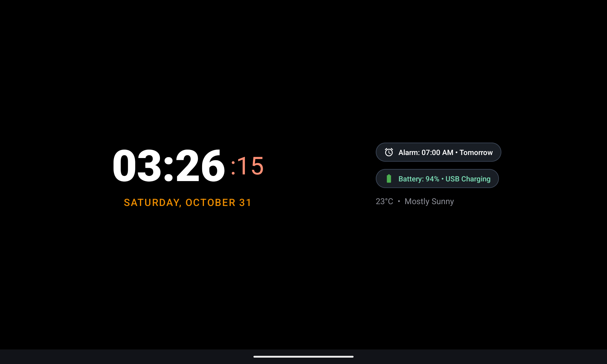

# Nest Bedside Hub 🌟
### The Ambient Smart Display for Android Tablets (Google Nest Meets Apple StandBy)

[-3DDC84?logo=android&logoColor=white)](https://developer.android.com)
[](https://github.com/Omar-Shady780/Nest-Hub/releases/latest)
[](https://github.com/Omar-Shady780/Nest-Hub/releases/latest)
[](https://opensource.org/licenses/MIT)
[](https://github.com/Omar-Shady780/Nest-Hub)

**Nest Bedside Hub** turns any Android tablet into an ambient Google Nest and Apple StandBy smart display designed for bedside nightstands and desk docks. It features zero-sleep bedside lock protection, vertical swipe StandBy clocks, customizable grid cards with span resizing, 20+ smart widgets, and native Android home screen widget embedding.

---

## 🚀 Live Website & Download

- **Live GitHub Pages Website**: [https://omar-shady780.github.io/Nest-Hub/](https://omar-shady780.github.io/Nest-Hub/)
- **Direct APK Download**: [Download NestBedsideHub.apk (v2.4.0)](https://github.com/Omar-Shady780/Nest-Hub/releases/latest/download/NestBedsideHub.apk)
- **GitHub Repository**: [https://github.com/Omar-Shady780/Nest-Hub](https://github.com/Omar-Shady780/Nest-Hub)
- **Downloads**: [](https://github.com/Omar-Shady780/Nest-Hub/releases/latest)

---

## 📸 Screenshots Showcase

| 🏠 Smart Dashboard | 🌙 OLED StandBy Digital | ⏱️ Chronograph Watchface |
| :---: | :---: | :---: |
|  |  |  |

---

## 🌟 Core Essential Features

### 1. OLED Pure Black StandBy Clocks
- **Fullscreen Nightstand Clocks**: Deep-sleep ambient clocks that seamlessly fade into pure zero-backlight OLED black.
- **Digital Clock**: High-contrast clock with live seconds alongside hours and minutes.
- **Chronograph Minimal Watchface**: Smooth sweeping analog watchface hands.
- **Bedside Status**: Live Next Scheduled Alarm pill, battery / USB charging indicator, and weather forecast with °C / °F toggle.

### 2. Custom Grid & Dynamic Slot Sizing
- **Flexible Grid Modes**: Effortlessly switch between 2×2 Grid (4 focus widgets), 3×3 Grid (9 widgets), or custom rows/columns.
- **Card Span Resizing**: Expand any card horizontally (2x Wide) or vertically (2x Tall).
- **Fluid Pinch Gestures**: Pinch inward or long-press on any card for instant zoom animation into per-widget settings.

### 3. Android Home Screen Widget Host
- **Native Android System Widgets**: Host Spotify, Google Calendar, Notes, Google Keep, or WhatsApp directly inside your bedside grid.
- **Adaptive Color Sync**: Native widgets and card accents dynamically blend into dark themes and wallpaper colors.
- **Full Touch Interactivity**: Interact with widgets directly on your bedside display.

### 4. Smart Physical Volume & Brightness HUD
- **Physical Volume Keys for Brightness**: Hardware volume buttons adjust display brightness smoothly with a sleek Sun HUD popup when silent.
- **Automatic Audio Routing**: Automatically routes volume buttons to media volume whenever music or podcasts are playing.
- **Zero-Sleep Bedside Lock**: Dedicated landscape orientation lock and wake-lock engine ensuring the display never turns off while docked.

> ✨ **Discover 20+ more features inside the app**: Adaptive Wallpaper Color Sync, Bedtime Red Shift melatonin filter, Ambient Sleep Sound machines, Quick Scratchpad, and First-Time Interactive Tutorial.

---

## 📦 Installation via ADB

```bash
# Install APK directly to connected Android tablet
adb install -r NestBedsideHub.apk

# Launch app
adb shell am start -n com.google.ambient.nesthub.debug/com.google.ambient.nesthub.MainActivity
```

---

## 🛠️ Tech Stack & Architecture

- **Platform**: Android 8.0 (API 26) through Android 17 (API 37)
- **Language**: Modern Java / Android SDK
- **Architecture**: Single Activity + ViewFlipper + Custom Responsive GridLayout
- **Animation System**: Hardware-accelerated cubic interpolators for dialog zooms and swipe flips
- **Widgets Engine**: Dynamic modular `WidgetViewHolder` + `PinchWidgetCard` + `AppWidgetHost`

---

## 📄 License

Distributed under the MIT License. See `LICENSE` for more information.
